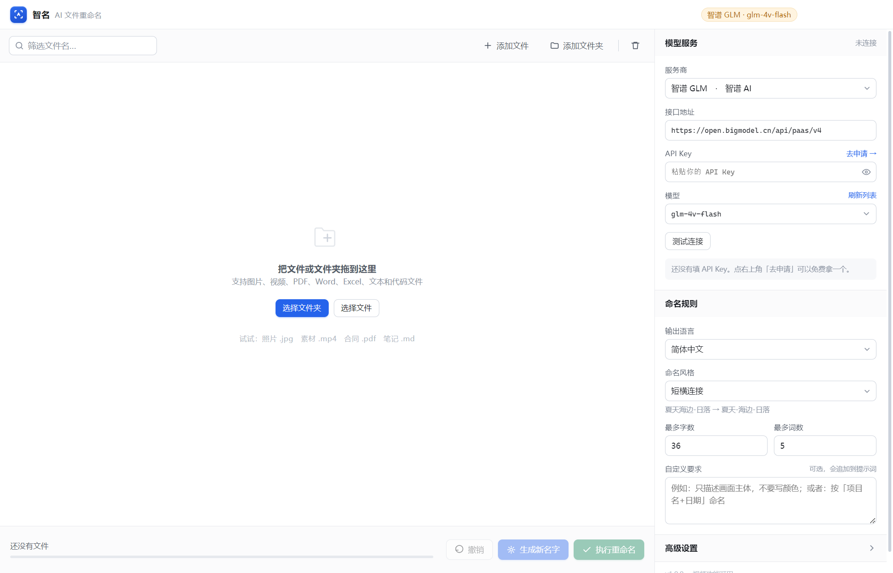

# 智名 · AI 文件重命名

> ### ⚠️ 本项目是衍生作品
>
> 基于 **[ozgrozer/ai-renamer](https://github.com/ozgrozer/ai-renamer)**（原作者 **Ozgur Ozer**）改写，
> 遵循上游的 **GPL-3.0** 协议发布。
> 原作者信息、修改范围、模块对应关系见 **[NOTICE.md](NOTICE.md)**，许可证全文见 **[LICENSE](LICENSE)**。
>
> 这是**中文桌面重写版**，不是上游项目本身。若需原版命令行工具，请访问上方上游仓库。

一个 Windows 桌面小工具：让 AI 看一眼文件内容，自动起一个**中文**名字。



手机拍的照片叫 `IMG_20260712_0931.jpg`，会议录屏叫 `VID_20260715_201455.mp4`，
扫描件叫 `新建文档(3).pdf` —— 这些都是给人看的文件，却配了个机器看的名字。
这个工具会读图片内容、抽视频画面、解析 PDF/Word/Excel 正文，然后给出像
`海边日落-沙滩剪影.jpg`、`Q3-渠道复盘-会议记录.pdf` 这样的名字。

---

## 一、开始使用

### 1. 拿一个模型 Key（推荐先白嫖）

| 服务商 | 免费模型 | 申请地址 |
|---|---|---|
| 智谱 AI | `glm-4v-flash`（看图）、`glm-4-flash`（读文字） | https://bigmodel.cn/usercenter/proj-mgmt/apikeys |
| 硅基流动 | `THUDM/GLM-4.1V-9B-Thinking` | https://cloud.siliconflow.cn/account/ak |
| 阿里百炼 | 新用户额度 | https://bailian.console.aliyun.com/ |

智谱的两个模型**完全免费**，注册后复制 Key 就能跑通，一分钱不花。

### 2. 打开软件

双击 `智名.exe`（或在源码目录执行 `npm start`）。

### 3. 三步搞定

```
右侧选服务商 → 粘贴 Key → 点「测试连接」
   ↓
把文件夹拖进窗口（或点「添加文件夹」）
   ↓
点「生成新名字」→ 逐个检查、可手改 → 点「执行重命名」
```

**不会立刻改文件。** 先生成一份预览，你确认无误再点执行；改完不满意，
点左下角「撤销」可以整批还原。

---

## 二、支持的模型

国内主流厂商都已内置，走到「服务商」下拉里选即可，无需手动填地址。

| 厂商 | 平台 | 看图 | 备注 |
|---|---|---|---|
| 通义千问 | 阿里云百炼 | ✅ | qwen-vl 系列识图准 |
| 智谱 GLM | 智谱 AI | ✅ | **有免费模型** |
| 硅基流动 | SiliconFlow | ✅ | 一个 Key 调几十种模型 |
| 豆包 | 火山引擎方舟 | ✅ | 可能需要先建接入点 |
| Kimi | 月之暗面 | ✅ | |
| 腾讯混元 | 腾讯云 | ✅ | |
| 文心一言 | 百度千帆 | ✅ | |
| MiniMax | MiniMax | ✅ | |
| 阶跃星辰 | StepFun | ✅ | |
| DeepSeek | 深度求索 | ❌ | 只能读文字类文件 |
| Ollama / LM Studio | 本机 | ✅ | 完全离线，文件不外传 |

> 选「自定义接口」可以接任何兼容 `/v1/chat/completions` 的服务，
> 比如自建 vLLM、OneAPI、FastGPT 网关。

**判断标准很简单**：模型名里带 `vl`、`vision`、`4v` 的才看得懂图片和视频；
纯文本模型只能处理 txt / md / pdf / word / excel / 代码。

---

## 三、支持的文件类型

| 类别 | 扩展名 | 处理方式 |
|---|---|---|
| 图片 | jpg jpeg png bmp webp gif tif tiff | 压缩后交给视觉模型识别画面 |
| 视频 | mp4 mov avi mkv wmv flv webm m4v mpg ts mts | ffmpeg 均匀抽 3 帧（可调）后识别 |
| 文档 | pdf docx xlsx txt md csv json xml html | 提取正文再交给模型 |
| 代码 | js ts py java go rs c cpp cs php rb 等 | 读取源码判断用途 |

几点说明：

- **扫描版 PDF** 没有文字层，读不到内容，会提示失败。
- **旧版 `.doc`** 是二进制格式，请先用 Word 另存为 `.docx`。
- **GBK 编码的 txt** 做了专门处理，不会乱码。
- **视频需要 ffmpeg**。软件启动时会自动检测，没装的话图片和文档仍可正常使用。
  安装：`winget install ffmpeg` 或从 https://ffmpeg.org 下载后把 bin 目录加进 PATH。

---

## 四、命名规则怎么调

右侧「命名规则」里有四项：

**输出语言** — 默认简体中文。

**命名风格** — 中文有四种断词方式，因为中文词之间没有空格：

| 风格 | 效果 |
|---|---|
| 短横连接 | 夏天-海边-日落 |
| 下划线连接 | 夏天_海边_日落 |
| 空格连接 | 夏天 海边 日落 |
| 连写 | 夏天海边日落 |

也保留了英文的 kebab-case / snake_case / camelCase，处理英文素材时可用。

> 风格不是靠事后替换实现的。提示词里会明确告诉模型「用短横线连接」，
> 所以模型断词后直接就是你要的形态，再由本地程序统一格式、清理非法字符。

**最多字数 / 最多词数** — 双重限制。字数按「字」算，一个汉字算 1 个。
建议 30～40 字，太长会变成一句话，反而不好认。

**自定义要求** — 优先级最高，会追加到提示词末尾。几个实用例子：

```
只写画面主体，不要写颜色和光线
按「项目名-日期-内容」的顺序命名
人名保留，其他用中文概括
如果是合同，写成「甲方-乙方-合同类型」
```

---

## 五、安全与隐私

- 文件**只在本机读取**。发给模型服务商的只有：图片（压缩后的副本）、
  视频抽帧图、或文档正文的前 6000 字。原始文件不会上传。
- 用本地 Ollama 时，全程不出本机。
- API Key 用 Windows 系统凭据（DPAPI）加密后保存，配置文件里是密文，
  路径为 `%APPDATA%\AiRenamerCN\settings.json`。
- 每次改名都会记一条撤销日志，保留最近 20 批。

---

## 六、常见问题

**Q：点了生成，全部失败，提示「API Key 无效」**
A：Key 复制时可能带了空格，或已经失效。到控制台重新生成一个再粘贴。

**Q：提示「模型返回为空」**
A：多数是模型不支持看图。换一个名字里带 `vl` / `vision` 的模型。

**Q：图片都失败，文字文件正常**
A：同上，当前模型不支持视觉输入。

**Q：视频全部失败**
A：九成是没装 ffmpeg。看软件右下角有没有「未检测到 ffmpeg」。

**Q：生成的名字是英文**
A：输出语言选成「跟随内容」时会这样；改成「简体中文」。另外小参数本地模型
有时不听指令，换大一点的模型（如 `qwen2.5vl:7b` 以上）。

**Q：名字太长，像一句话**
A：把「最多字数」调到 20 以内，「最多词数」调到 3～4。

**Q：改错了能恢复吗**
A：能。左下角「撤销」按批次整批还原，恢复原文件名。

**Q：能不能只改一部分**
A：列表左侧的勾选框控制哪些参与生成和执行，也可以单独改某一行的新名字。

---

## 七、源码结构

```
ai-renamer-cn/
├── main.js                 Electron 主进程：窗口、IPC、文件对话框
├── preload.js              安全桥，只暴露明确列出的方法
├── lib/
│   ├── presets.js          国产厂商预置表（地址、模型、申请链接）
│   ├── providers.js        模型调用：OpenAI 兼容协议 + Ollama 原生协议
│   ├── prompt.js           中文提示词构造
│   ├── namer.js            中文命名规范化（本项目改动最大的部分）
│   ├── readers.js          文本/PDF/Word/Excel 读取，含 GBK 编码识别
│   ├── frames.js           ffmpeg 抽帧
│   ├── scanner.js          文件扫描与分类
│   ├── renamer.js          生成调度（并发）+ 两阶段改名 + 撤销
│   └── store.js            配置持久化（Key 加密）
├── renderer/               界面（纯 HTML/CSS/JS，无框架）
├── test/                   测试
└── scripts/make-icon.js    生成应用图标
```

### 相对原项目的关键改动

原项目 https://github.com/ozgrozer/ai-renamer 是一个 Node.js 命令行工具。

| 方面 | 原版 | 本版 |
|---|---|---|
| 交互 | 命令行参数 | 桌面 GUI，可预览、可逐条修改、可撤销 |
| 模型 | Ollama / LM Studio / OpenAI | 增加 10 家国产厂商，默认中文 |
| 提示词 | 英文，要求输出英文 | 中文，要求输出中文并按指定分隔符断词 |
| 命名 | `change-case` 做大小写转换 | 重写：中文分词式拼接、字数截断、非法字符清理、保留字规避 |
| 并发 | 逐个串行 | 可配置并发（默认 3） |
| 撤错 | 无 | 两阶段改名 + 撤销日志 |
| 视频 | 临时目录写死 `/tmp`，Windows 上不可用 | 改用系统临时目录，并修复短视频除零 |
| 视频抽帧 | `fps` 滤镜均分 | 按时间片中点逐帧 seek，避开片头黑场 |
| 文本 | 只按 UTF-8 读 | BOM / UTF-8 / UTF-16 / GBK 自动识别 |
| 文档 | 仅 PDF | 增加 docx / xlsx |

### 开发

```bash
npm start          # 启动
npm test           # 全部测试（命名引擎 / 改名引擎 / 文档读取 / 端到端链路）
npm run icon       # 重新生成图标
npm run build      # 打包 exe
```

测试覆盖 121 项断言，包括「两个文件互换名字不会丢数据」「撤销时原文件名被占用」
「GBK 中文不乱码」「模型输出带前缀和引号能被清洗干净」这类容易出事的边界。

---

## 八、许可证与致谢

本项目以 **GNU General Public License v3.0** 发布，全文见 [LICENSE](LICENSE)。

它衍生自 [ai-renamer](https://github.com/ozgrozer/ai-renamer)（作者 Ozgur Ozer，GPL-3.0）。
上游的作者、仓库地址、修改范围与模块对应关系，都记在 [NOTICE.md](NOTICE.md) 里。

**这意味着什么**，如果你是使用者或想二次开发：

- 你可以自由使用、修改、再分发，**包括商用和收费**；
- 但对外分发时必须同样以 GPL-3.0 开源，并向接收者提供完整源码；
- 不能把它改成闭源软件再分发（收费可以，但源码不能藏）；
- 二次开发时请保留 [NOTICE.md](NOTICE.md) 和 [LICENSE](LICENSE)。

如果你希望闭源分发或换用其他许可证，需要联系上游作者获得授权。

### 致谢

- [ai-renamer](https://github.com/ozgrozer/ai-renamer) —— 项目起点
- [Electron](https://www.electronjs.org/)、[pdf-parse](https://www.npmjs.com/package/pdf-parse)、
  [JSZip](https://stuk.github.io/jszip/)、[FFmpeg](https://ffmpeg.org/) —— 基础设施

